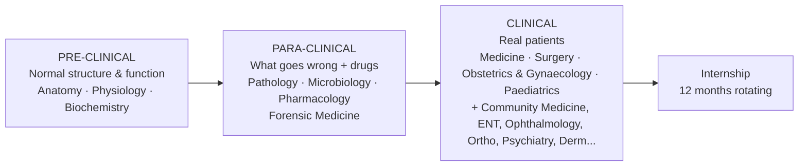

Session 1 · Phase 0 — Module 0.1 (How medicine is organised + the language of medicine) · Streak 1 · Today's focus: how the MBBS is layered, and how to decode any medical word

*Education only. Not medical advice.*

---

## Part A — Diagnostic (3 min, first run only)

These five questions don't count towards your score. They tell me where to start you. Guess if you don't know, and say "guess" next to it.

**D1.** Which part of a cell makes most of its ATP (usable energy)?
A. Ribosome  B. Mitochondrion  C. Golgi apparatus  D. Lysosome

**D2.** Normal blood pH is about 7.4. A patient's blood pH falls to 7.1. Compared with normal, the hydrogen-ion (H⁺) concentration is now roughly:
A. Half  B. Double  C. 30 times higher  D. Unchanged

**D3.** Five patients wait in a clinic for 2, 3, 3, 8 and 50 minutes. What is the median waiting time?
A. 3 min  B. 8 min  C. 13.2 min  D. 50 min

**D4.** In a trial, 10% of patients on placebo had a heart attack versus 8% on the new drug. What is the *relative* risk reduction?
A. 2%  B. 8%  C. 20%  D. 80%

**D5.** A lab report flags "thrombocytopenia". This most likely means:
A. Low platelet count  B. A blood clot in a vein  C. Low red-cell count  D. Inflamed blood vessel

---

## Part B — Lesson (10 min)

### The big idea
Medical training is built in three layers: first how the **normal** body is built and works (pre-clinical), then how it **goes wrong** and how drugs act on it (para-clinical), then how to **recognise and treat** illness in real patients (clinical). Medical language is built the same way, from small Latin and Greek parts, so once you know about 50 parts you can decode thousands of words you've never seen.

### Mechanism: why it's layered this way



Each layer needs the one before it. You can't see that a kidney is failing (clinical) without knowing what a working kidney filters (physiology) and what damage looks like under a microscope (pathology). Most mistakes in reasoning come from skipping a layer. The roadmap in this repo follows the same order.

The Indian MBBS (NMC's Competency-Based Medical Education, CBME) runs about 4.5 years in these phases, then a 12-month compulsory rotating internship. **NEET-UG** is the entrance exam. It has 180 questions (Physics 45, Chemistry 45, Biology 90), 720 marks, +4 for a correct answer and −1 for a wrong one, and its biology is NCERT Class XI–XII. **NEET-PG** is the postgraduate entrance exam taken after MBBS, and it is meant to be replaced by NExT, which has been delayed several times.

### Word-building: the decoder
Most medical words are **[prefix] + root + [combining vowel, usually "o"] + suffix**. Read them **from the end first**:

```
gastr  - o - enter - o - logy
stomach      intestine    study of     →  the study of the stomach and intestines

peri - card - itis
around  heart   inflammation          →  inflammation of the sac around the heart
```

**Suffixes that change everything (surgery):**

| Suffix | Meaning | Example |
|---|---|---|
| **-ectomy** | cut **out** (remove) | appendectomy: the appendix is removed |
| **-otomy** | cut **into** (an incision) | laparotomy: the abdomen is opened |
| **-ostomy** | make a **mouth** (an opening to the surface) | colostomy: the colon opens onto the skin |
| **-scopy** | look inside with a scope | endoscopy |

### Terminology box (added to `glossary.md`)

| Part | Meaning | Example |
|---|---|---|
| hepat- | liver | hepat**itis** = liver inflammation |
| nephr- / ren- | kidney (Greek / Latin) | **nephr**opathy, **ren**al failure |
| cardi- | heart | **cardi**ology |
| -itis | inflammation | arthr**itis** |
| -megaly | enlargement | spleno**megaly** |
| -pathy | disease (of) | neuro**pathy** |
| -aemia / -emia | condition of the blood | anaemia, hyperglyc**aemia** |
| -penia | deficiency, too few | leuco**penia** = low white cells |
| hyper- / hypo- | above / below normal | **hyper**tension, **hypo**thyroidism |
| tachy- / brady- | fast / slow | **tachy**cardia = fast heart rate |
| chol(e)- / cyst- | bile / bladder or sac | **chole****cyst****ectomy** = gallbladder removal |
| lapar- | abdomen (abdominal wall) | **lapar**oscopy = keyhole abdominal surgery |

### In the doctor's office
Indian case sheets and prescriptions use shorthand constantly:

- **c/o** = complains of. **h/o** = history of. **k/c/o** = "known case of", very common in India, e.g. *"k/c/o T2DM, HTN"* = known diabetic with high BP. **s/p** = status post (has already had), e.g. *"s/p appendectomy 2019"*.
- **Dx** diagnosis · **Rx** treatment or prescription · **Hx** history · **Ix** investigations.
- Prescription timing (from Latin): **OD** once daily · **BD** twice daily · **TDS** three times daily · **HS** at bedtime · **SOS** only if needed.

**A question worth asking:** when a doctor uses a word you don't know, ask *"Is that the name of a disease, or a description of what you're seeing?"* For example, "hepatomegaly" (a big liver) only *describes* what they found. It isn't a diagnosis. The useful follow-up is "what's causing it?"

### In the journal
Paper titles and outcomes are written in this vocabulary. "Incidence of diabetic **nephropathy**", "post-operative **tachyarrhythmia** after **cholecystectomy**", "**hypo**glycaemic events" as a safety endpoint. Journals are organised the same way as departments, so *The Lancet* is general, *Lancet Oncology* covers cancer and *Hepatology* covers the liver. Decoding the title is step one in reading any abstract.

---

## Part C — Quiz (6–8 min)

**Q1.** Which group of MBBS subjects is *pre-clinical*?
A. Anatomy, Physiology, Biochemistry
B. Pathology, Microbiology, Pharmacology
C. Medicine, Surgery, Obstetrics & Gynaecology
D. Community Medicine, ENT, Ophthalmology

**Q2.** A surgical note says "left nephrectomy". What was done?
A. The left kidney was found inflamed
B. The left kidney was removed
C. An incision was made into the left kidney to take out a stone
D. The left kidney was imaged with a scope

**Q3.** Your uncle's ultrasound report says "hepatomegaly", and his blood report flags "hyperbilirubinaemia". The best plain-English summary is:
A. Inflamed liver; low bilirubin in the blood
B. Enlarged liver; high bilirubin in the blood
C. Enlarged spleen; high bilirubin in the blood
D. Liver tumour; bilirubin found in the urine

**Q4.** A relative's discharge summary reads: *"s/p laparoscopic cholecystectomy. Post-op tachycardia, resolved."* What happened?
A. Gallbladder removed by keyhole surgery; a fast heart rate after the operation has settled
B. Gallbladder inflamed and examined with a scope; high blood pressure afterwards
C. Gallstones dissolved with medicine; an irregular heartbeat has settled
D. Stomach opened with a large incision; a slow heart rate afterwards

**Q5.** After bowel-cancer surgery, the surgeon tells a friend's father he'll have a "temporary colostomy". What does this mean for him?
A. Part of his colon has been removed and nothing else changes
B. His colon has been brought out through an opening in the belly wall, so stool collects in a bag for now
C. He will have a camera passed into his colon every few months
D. His colon was cut into to remove a polyp and then closed

**Q6 (short answer, 3–4 sentences).** In your own words, explain why medicine is taught in the order *pre-clinical → para-clinical → clinical*. What does each layer give the next one? Use one example of your own (not the kidney example above).

---

## Your answers
<!-- Reply in the session like: D: 1B 2? 3A 4C 5A | Quiz: 1B 2D 3A 4C 5B | Q6: ... | Minutes: __ -->

---

### Sources
- NEET-UG pattern (180 Qs, 720 marks, +4/−1): [Careers360, NEET exam pattern 2026](https://medicine.careers360.com/article/24046); [Medical Dialogues, NEET 2026 pattern](https://medicaldialogues.in/amp/news/education/medical-admissions/neet-2026-on-may-3-check-exam-pattern-for-mbbs-entrance-test-165456)
- MBBS phase structure (NMC CBME): [Medical Dialogues, NMC CBME guidelines 2024](https://medicaldialogues.in/health-news/nmc/mbbs-curriculum-nmc-releases-cbme-guidelines-2024-details-134177); [Careers360, MBBS syllabus](https://medicine.careers360.com/articles/mbbs-syllabus)
